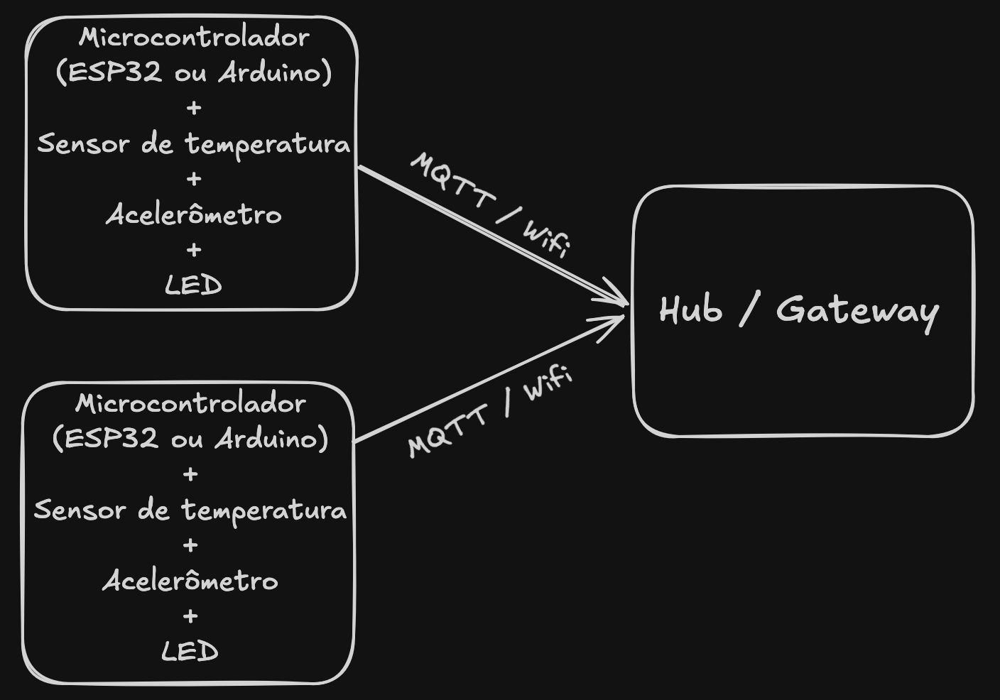

# Swifties — Manutenção Preditiva de Ativos Industriais

**Software para Sistemas Ubíquos (INF0483) — UFG 2026/2** · Integrantes: Guilherme Iago, João Victor Lemes, Marcos Sousa, Yasmin Moura

Um nó ESP32 (simulado no Wokwi) mede a **vibração** (MPU6050) e a **temperatura** (2× DS18B20) de um motor e publica eventos por MQTT. Um **hub local** em Python aplica uma regra com estado e janela de tempo e classifica o ativo em `NORMAL`, `ATENCAO`, `CRITICO`, `SEM_COMUNICACAO` ou `NAO_AVALIAVEL` (máquina desligada). A decisão aparece no **app Android** e no **dashboard web** e fica gravada no **TimescaleDB**.



---

## 🎬 Vídeo do Marco 4

[https://drive.google.com/file/d/126eFsVrj20s0RGd1aHsGYtLsl58nMpLv/view?usp=sharing](https://drive.google.com/file/d/126eFsVrj20s0RGd1aHsGYtLsl58nMpLv/view?usp=sharing)

---

## ✅ Marco 4 — itens obrigatórios

| Item | Onde está | Situação |
|---|---|---|
| **1. Aplicativo móvel** | Código: [`mobile/`](mobile/) (React Native/Expo) · instruções: [`mobile/README.md`](mobile/README.md)  | ✅ |
| **2. Persistência de dados** (banco temporal) | [`consumidor/db.py`](consumidor/db.py), esquema [`consumidor/db/schema.sql`](consumidor/db/schema.sql) (hypertables, compressão em 7 dias, retenção de 1 ano) · descrição em [`consumidor/README.md`](consumidor/README.md#persistência-timescaledb) | ✅ TimescaleDB |
| **3. Testes automatizados** | [`docs/testes.md`](docs/testes.md): comandos, módulos cobertos, rastreabilidade com os requisitos e evidências · CI: [`.github/workflows/tests.yml`](.github/workflows/tests.yml) | ✅ unitários + integração |
| **4. Documentação técnica de implantação** | Seção [Como executar](#-como-executar) abaixo + um README por componente | ✅ |
| **5. Relatório técnico (artigo)** | [`docs/RelatorioTecnico.pdf`](docs/RelatorioTecnico.pdf) | ✅ |

### Requisitos mantidos

| Requisito | Onde está |
|---|---|
| Dois produtores, decisão e resposta | Produtores: fluxos de vibração e de temperatura do nó ([`publisher/`](publisher/)) e o publicador simulado ([`consumidor/ferramentas/mock_publisher.py`](consumidor/ferramentas/mock_publisher.py)) · decisão: [`consumidor/main.py`](consumidor/main.py) · resposta: app, dashboard e LED do nó |
| Mudança de contexto | Máquina `DESLIGADA` suspende o diagnóstico (`NAO_AVALIAVEL`), e 15 s sem eventos geram `SEM_COMUNICACAO`. Demonstrado em `test_fluxo.py::test_mudanca_de_contexto_maquina_desligada` e `test_falha.py::test_silencio_…` |
| Contratos e validação | Contrato de eventos v1, tópicos e validações: [`publisher/README.md`](publisher/README.md#contrato-v1) · contrato da decisão: [`dashboard/README.md`](dashboard/README.md) |
| Regra com estado, tempo e combinação | Janela deslizante de 30 s por ativo, linha de base aprendida, `CRITICO` exige RMS alto **e** curtose ou ΔT: [`docs/arquitetura.md`](docs/arquitetura.md) e [`consumidor/README.md`](consumidor/README.md) |
| Arquitetura e diagramas | Visões 4+1: [`docs/arquitetura.md`](docs/arquitetura.md) · fontes PlantUML: [`docs/diagramas/`](docs/diagramas/) · requisitos: [`docs/requisitos.md`](docs/requisitos.md) |
| Autenticação e autorização | Usuário/senha e ACL no Mosquitto: [`broker/acl`](broker/acl), [`broker/README.md`](broker/README.md) · testado em [`tests/integracao/test_seguranca.py`](tests/integracao/test_seguranca.py) |
| Segredos fora do Git | Só arquivos `.env.example` (os `.env` estão no `.gitignore`). `broker/passwd` guarda apenas hashes das credenciais de teste |
| Falha e recuperação | Buffer *store-and-forward* e *last will* no nó ([`publisher/README.md`](publisher/README.md#buffer-e-enlace)). Banco e broker fora do ar com recuperação automática, testados em [`tests/integracao/test_falha.py`](tests/integracao/test_falha.py) |

### Verificações pedidas → evidência

Todas automatizadas e executadas no CI a cada push ([última execução no `main`](https://github.com/UFG-INF-SSU-2026/swifties/actions/runs/45091967513)). O detalhe de cada teste está em [`docs/testes.md`](docs/testes.md#verificações-exigidas--testes-de-integração).

| Verificação | Testes |
|---|---|
| Fluxo e contexto | [`test_fluxo.py`](tests/integracao/test_fluxo.py): baseline → `CRITICO` em menos de 30 s · `ATENCAO` por ΔT · máquina desligada · pico isolado não gera alarme · inválidos e duplicatas são ignorados |
| Persistência | [`test_persistencia.py`](tests/integracao/test_persistencia.py): gravação e **recuperação por SQL** · dados preservados após **reiniciar o banco** e **reiniciar o consumidor** · reenvio não duplica |
| Segurança | [`test_seguranca.py`](tests/integracao/test_seguranca.py): senha errada, usuário inexistente e cliente anônimo **rejeitados** · nó não publica como outro dispositivo nem lê decisões (**ACL**) · TLS marcado como pendente (`xfail`) |
| Falha e recuperação | [`test_falha.py`](tests/integracao/test_falha.py): **banco fora** (o hub continua decidindo e grava ao voltar) · **broker fora** (o consumidor reconecta) · silêncio do nó → `SEM_COMUNICACAO` e retorno |

---

## 🚀 Como executar

Pré-requisitos: **Docker** com Compose, **Python 3.12**, **Node 22**, Expo (app) e, para o nó real, uma conta no Wokwi e uma conta ngrok com cartão verificado.

| Ordem | Componente | Comando | Detalhes |
|---|---|---|---|
| 1 | Broker Mosquitto 2 (+ ngrok para o Wokwi) | `cd broker && cp .env.example .env && docker compose up -d` | [`broker/README.md`](broker/README.md) |
| 2 | TimescaleDB (PostgreSQL 16) | VPS do grupo ou local: `docker run -d -p 5432:5432 -e POSTGRES_USER=swifties -e POSTGRES_PASSWORD=<senha> -e POSTGRES_DB=swifties timescale/timescaledb:latest-pg16` | O esquema é aplicado sozinho pelo consumidor |
| 3 | Consumidor (hub) | `cd consumidor && cp .env.example .env` (preencher `POSTGRES_*`) `&& docker compose up --build` | [`consumidor/README.md`](consumidor/README.md) |
| 4 | Dashboard web (Nginx, porta 8080) | `cd dashboard && docker compose up -d` → http://localhost:8080 | [`dashboard/README.md`](dashboard/README.md) |
| 5 | App móvel | `cd mobile && npm install && npx expo start` (ou instalar o APK) e, em **Configurações**, informar o IP do broker e a porta 9001 | [`mobile/README.md`](mobile/README.md) |
| 6 | Produtor | Nó no Wokwi ([`publisher/README.md`](publisher/README.md)) **ou**, sem Wokwi: `python consumidor/ferramentas/mock_publisher.py --cenario critico` | Roteiro de demonstração em [`publisher/README.md`](publisher/README.md#roteiro-de-demonstração) |

**Credenciais de teste** (fictícias, apenas acadêmicas; ver [`broker/README.md`](broker/README.md#autenticação-e-autorização)):

| Usuário | Senha | Papel |
|---|---|---|
| `esp32-07` | `esp32123` | nó sensor: só publica em `swifties/esp32-07/#` |
| `consumidor` | `consumidor123` | hub: lê `swifties/#` e escreve `consumidor/#` |
| `admin` | `admin123` | leitura e escrita totais (usado hoje pelo app e pelo dashboard, ver limitações) |

### Testes

```bash
./scripts/test-all.sh                # unitários: consumidor, publisher, dashboard e mobile
./scripts/test-all.sh --integracao   # + integração (exige Docker; sobe Mosquitto e TimescaleDB sozinho)
```

| Suíte | Ferramenta | Onde |
|---|---|---|
| Consumidor e publisher (unitários) | pytest | [`tests/consumidor`](tests/consumidor), [`tests/publisher`](tests/publisher) |
| Dashboard | node:test + jsdom | [`dashboard/test`](dashboard/test) |
| App móvel | jest-expo + Testing Library | [`mobile/__tests__`](mobile/__tests__) |
| Integração (broker e banco reais) | pytest + Docker Compose | [`tests/integracao`](tests/integracao) |

Evidências: [`docs/evidencias/testes/`](docs/evidencias/testes/) e o artefato `evidencias-integracao` de cada execução do CI.

---

## 📁 Estrutura do repositório

| Pasta | Conteúdo |
|---|---|
| [`publisher/`](publisher/) | Firmware do nó ESP32 (MicroPython, Wokwi) |
| [`broker/`](broker/) | Mosquitto com autenticação e ACL, mais o túnel ngrok |
| [`consumidor/`](consumidor/) | Hub: regra de decisão e persistência no TimescaleDB |
| [`dashboard/`](dashboard/) | Painel web (JavaScript e MQTT sobre WebSocket) |
| [`mobile/`](mobile/) | App Android (React Native/Expo) |
| [`tests/`](tests/) | Testes Python unitários e de integração |
| [`docs/`](docs/) | Requisitos, arquitetura 4+1, testes, relatório técnico e [Atividade 01](docs/atividade01.md) |
