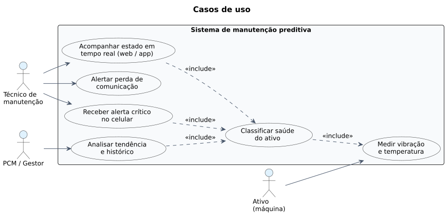
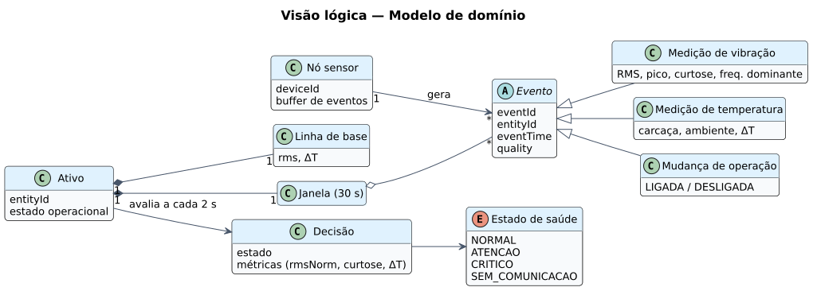
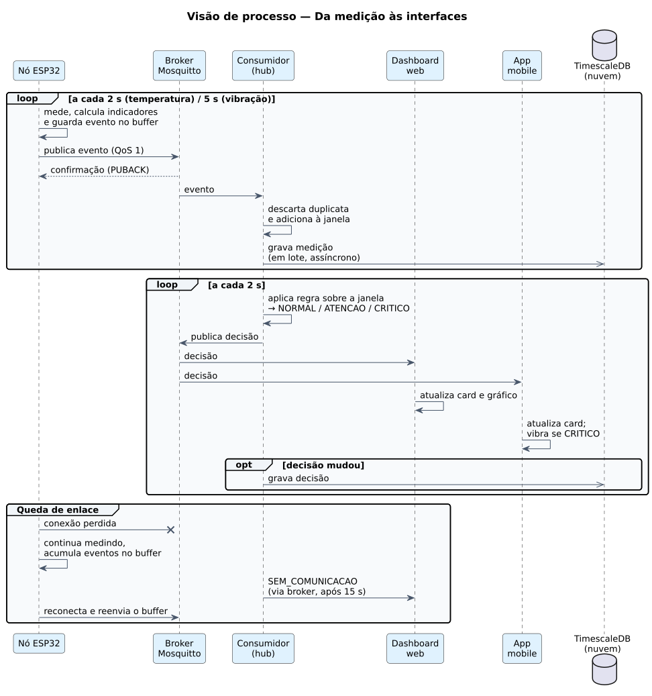
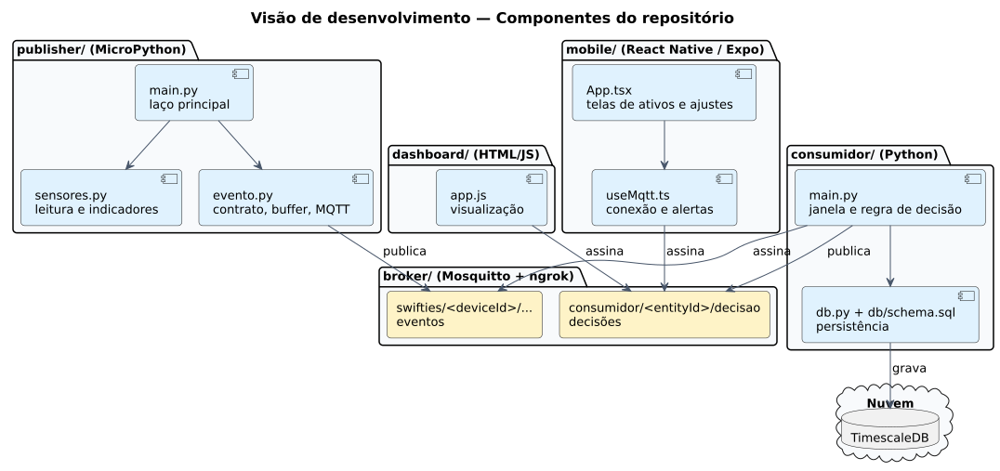
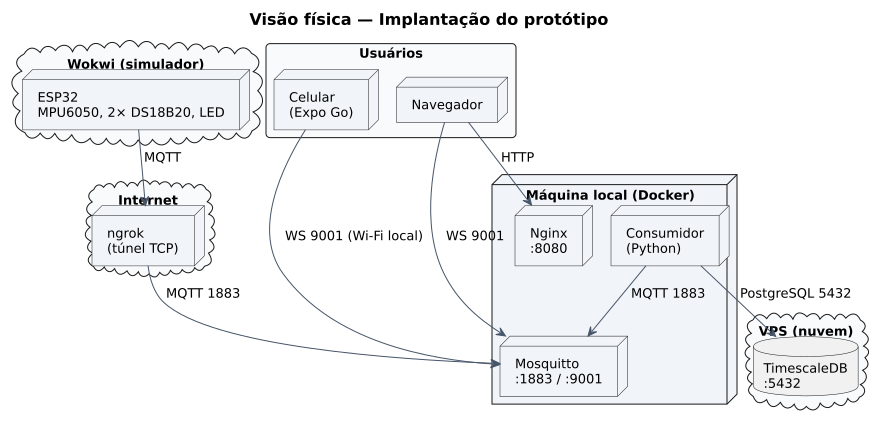

# Arquitetura — Visões 4+1

Sistema de manutenção preditiva: um nó ESP32 mede vibração e temperatura de um motor, um hub local (consumidor) decide o estado de saúde do ativo e um dashboard web e um app mobile mostram o resultado em tempo real. Tudo se comunica por MQTT.

## Cenários (+1) — Casos de uso

- O **ativo** gera os sinais; o sistema mede e classifica sua saúde.
- O **técnico** acompanha o estado em tempo real, pelo navegador ou pelo celular, e é avisado quando um nó para de se comunicar.
- No **app mobile**, o celular vibra quando um ativo entra em estado crítico.
- O **PCM/gestor** usa a tendência e o histórico para programar a manutenção.

## Visão lógica

- O nó gera três tipos de **evento**: medição de vibração, medição de temperatura e mudança de operação (ligada/desligada).
- Para cada **ativo**, o hub mantém uma **janela** de 30 s de eventos e uma **linha de base** aprendida no início.
- A cada 2 s, o hub compara a janela com a linha de base e emite uma **decisão**: `NORMAL`, `ATENCAO`, `CRITICO` ou `SEM_COMUNICACAO`.
- `CRITICO` exige vibração alta **e** confirmação (curtose ou temperatura). Um pico isolado não dispara alarme.

## Visão de processo

- O nó publica com **QoS 1** e só apaga um evento do buffer após a confirmação do broker.
- O hub **descarta duplicatas** pelo `eventId`, então reenvios não alteram a decisão.
- A decisão é publicada uma vez e chega ao **dashboard e ao app ao mesmo tempo**: o broker entrega a todos os assinantes.
- Se o enlace cai, o nó continua medindo e **reenvia o buffer** ao reconectar. Enquanto isso, o hub marca o ativo como `SEM_COMUNICACAO`.

## Visão de desenvolvimento

- São cinco componentes independentes no repositório. Nenhum importa código de outro.
- O acoplamento é só pelos **tópicos MQTT**: eventos (`swifties/...`) e decisões (`consumidor/.../decisao`).
- O **app mobile** (React Native/Expo) reaproveita o mesmo tópico e payload do dashboard, sem mudança no consumidor.
- O broker aplica autenticação e ACL: cada componente só lê e escreve nos seus tópicos.

## Visão física

- O ESP32 roda no simulador **Wokwi** e alcança o broker local por um túnel **ngrok**.
- Broker, consumidor e dashboard (Nginx) rodam em containers **Docker** na máquina local.
- O navegador carrega o dashboard por HTTP e recebe as decisões por MQTT sobre WebSocket.
- O **celular** roda o app no Expo Go e se conecta ao mesmo WebSocket pela rede Wi-Fi local, usando o IP configurado no app.
- **Em produção**, o ngrok sai: o nó usa o Wi-Fi da planta para chegar a um hub local, com TLS e uma camada de nuvem para o histórico.

---

Fontes dos diagramas em [`diagramas/`](diagramas/) (PlantUML). Para regenerar: `java -jar plantuml.jar -tsvg -o svg diagramas/*.puml`.
