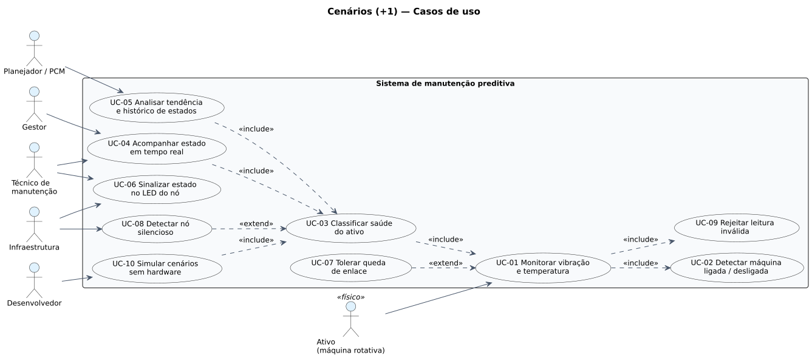

# Cenários (+1)

**Propósito:** mostrar o sistema pelo ponto de vista de quem o usa e validar que as quatro visões, juntas, realizam esses usos. Cada cenário percorre lógica, processo, desenvolvimento e física.

**Público:** todas as partes interessadas.

## Casos de uso

| Ator | Interesse |
|---|---|
| **Técnico de manutenção** | Saber o que inspecionar agora: estado no dashboard e LED no ativo. |
| **Planejador / PCM** | Tendência e histórico de estados, para programar a parada. |
| **Gestor** | Visão do risco de parada dos ativos. |
| **Infraestrutura** | Detectar nó silencioso e problemas de enlace. |
| **Desenvolvedor** | Exercitar o sistema sem hardware. |
| **Ativo** (ator físico) | Fonte do fenômeno: vibração e calor. |

| UC | Caso de uso | Requisitos |
|---|---|---|
| UC-01 | Monitorar vibração e temperatura | RF-01 – RF-03, RF-06, RF-07 |
| UC-02 | Detectar máquina ligada / desligada | RF-05, RF-20 |
| UC-03 | Classificar saúde do ativo | RF-21 – RF-25 |
| UC-04 | Acompanhar estado em tempo real | RF-26 – RF-29, RF-33 |
| UC-05 | Analisar tendência e histórico de estados | RF-30, RF-31 |
| UC-06 | Sinalizar estado no LED do nó | RF-11 (enlace); RP-02 (decisão, planejado) |
| UC-07 | Tolerar queda de enlace | RF-08 – RF-10, RF-18 |
| UC-08 | Detectar nó silencioso | RF-10, RF-24, RF-32 |
| UC-09 | Rejeitar leitura inválida | RF-04, RF-19 |
| UC-10 | Simular cenários sem hardware | RF-34 |

> **UC-06 no protótipo:** o LED do nó mostra o estado do **enlace e das leituras** do próprio nó. Acender o LED com a cor da **decisão** do hub (verde / amarelo / vermelho) faz parte da arquitetura-alvo (RP-02). A ACL atual não dá ao nó permissão de leitura.

## Cenários

Cada cenário corresponde a um passo do roteiro de demonstração em [`publisher/README.md`](../../publisher/README.md) ou a um cenário do `mock_publisher.py`.

### CN-01 — Monitoramento nominal

| | |
|---|---|
| **Atores** | Ativo, Técnico |
| **Pré-condição** | Broker, consumidor e dashboard no ar; nó conectado; máquina `LIGADA` com acelerômetro deslocado ~2 g. |
| **Fluxo** | 1. O nó publica `medicao.temperatura` a cada 2 s e `medicao.vibracao` a cada 5 s. 2. O consumidor acumula ≥ 3 amostras de cada fluxo e publica `DADOS_INSUFICIENTES` enquanto isso. 3. A primeira janela válida vira a linha de base, e o consumidor publica `NORMAL`. 4. O dashboard mostra o card verde com RMS norm. ≈ 1,0. |
| **Resultado** | Estado `NORMAL` visível em ≤ ~15 s após o boot; gráfico atualizado a cada 2 s. |
| **Visões** | Processo: [fluxo nominal](03-visao-processo.md#fluxo-nominal). Lógica: [estado de saúde](02-visao-logica.md#estado-de-saúde-do-ativo). Física: [protótipo](05-visao-fisica.md#implantação-do-protótipo). |

### CN-02 — Máquina desligada e religada

| | |
|---|---|
| **Atores** | Ativo, Técnico |
| **Fluxo** | 1. O acelerômetro volta ao repouso (0, 0, 1 g), e o RMS cai abaixo de 0,10 g. 2. Após 2 janelas (~10 s), o nó emite `maquina.mudanca_operacao` com `DESLIGADA`. 3. O consumidor publica `NAO_AVALIAVEL`, e o card fica cinza. 4. Com o acelerômetro deslocado de novo (≥ 0,20 g por 2 janelas), o nó emite `LIGADA` e a avaliação recomeça. |
| **Resultado** | Nenhum diagnóstico é emitido sobre máquina parada. |
| **Visões** | Lógica: [estados do nó](02-visao-logica.md#estados-do-nó). |

### CN-03 — Queda de enlace (simulada pelo botão)

| | |
|---|---|
| **Atores** | Infraestrutura, Técnico |
| **Fluxo** | 1. O botão fecha o socket sem DISCONNECT. 2. O broker publica `OFFLINE` (last will), e o LED do nó fica vermelho. 3. O nó continua medindo e guarda os eventos no buffer. 4. Após 15 s sem eventos, o consumidor publica `SEM_COMUNICACAO` e o card fica laranja. 5. O botão restabelece o enlace: `ONLINE`, LED amarelo, buffer drenado em ordem de `sequence` com o `eventTime` original. 6. Duplicatas são descartadas, e o estado volta a ser avaliado. |
| **Resultado** | `perdidos = 0` para quedas de até ~140 s. A queda fica visível no LED, no `mosquitto_sub` e no dashboard. |
| **Visões** | Processo: [queda de enlace](03-visao-processo.md#queda-de-enlace-com-store-and-forward). Lógica: [enlace](02-visao-logica.md#estados-do-nó). |

### CN-04 — Falha real do broker

| | |
|---|---|
| **Atores** | Infraestrutura |
| **Fluxo** | 1. `docker compose stop mosquitto`. 2. O publish do nó falha; o evento permanece no buffer e o nó tenta reconectar a cada 5 s. 3. O dashboard mostra "Broker Offline", e os cards ficam desatualizados após 8 s. 4. `docker compose start mosquitto`: o nó reconecta e drena o buffer; o consumidor (paho) reconecta e reassina. |
| **Resultado** | O sistema se recupera sem intervenção manual além de religar o broker. |
| **Visões** | Processo; Física. |

### CN-05 — Leitura inválida (sensor solto ou com defeito)

| | |
|---|---|
| **Atores** | Ativo, Infraestrutura |
| **Fluxo** | 1. A temperatura da carcaça varia bruscamente (> 5 °C/min) **ou** os três eixos do MPU6050 são zerados. 2. O nó publica o evento com `quality: "INVALIDO"` e `motivo` (`salto_de_temperatura` / `mpu_fora_de_faixa`), e o LED fica magenta. 3. O consumidor registra `[INVALIDO]` e não usa o evento na janela. |
| **Resultado** | A leitura espúria não contamina a decisão, e a falha do sensor fica visível. |
| **Visões** | Lógica: [validação](02-visao-logica.md#modelo-de-domínio). Processo: [recepção no hub](03-visao-processo.md#hub-recepção-de-eventos). |

### CN-06 — Degradação até estado crítico

| | |
|---|---|
| **Atores** | Ativo, Técnico, PCM |
| **Pré-condição** | Linha de base aprendida (CN-01). |
| **Fluxo** | 1. A intensidade de vibração sobe de forma sustentada (sliders do MPU6050, ou `mock_publisher --cenario atencao`). 2. Quando ≥ 80 % das vibrações da janela passam de 1,5 × a base (ou ΔT ≥ base + 10 °C), o consumidor publica `ATENCAO`. 3. Com RMS normalizado ≥ 2,0 confirmado por curtose ≥ 6 ou ΔT ≥ base + 20 °C (`--cenario critico`), o consumidor publica `CRITICO`. 4. O card fica vermelho pulsante, o histórico registra a transição e o gráfico mostra a tendência. |
| **Resultado** | A degradação é sinalizada em até uma janela (30 s). Um pico isolado não dispara alarme. |
| **Visões** | Lógica: [regra de decisão](02-visao-logica.md#estado-de-saúde-do-ativo). Processo: [ciclo de avaliação](03-visao-processo.md#hub-ciclo-de-avaliação). |

### CN-07 — Teste sem hardware

| | |
|---|---|
| **Atores** | Desenvolvedor |
| **Fluxo** | 1. Subir o broker e o consumidor localmente. 2. Rodar `python3 consumidor/ferramentas/mock_publisher.py --cenario <nome>`, com `<nome>` ∈ `normal`, `atencao`, `critico`, `desligada`, `invalido`, `duplicata` ou `sem_comunicacao`. 3. Observar logs e dashboard. |
| **Resultado** | Cada ramo da regra de decisão pode ser exercitado de forma reprodutível, sem Wokwi nem ngrok. |
| **Visões** | Desenvolvimento: [componentes](04-visao-desenvolvimento.md). |
