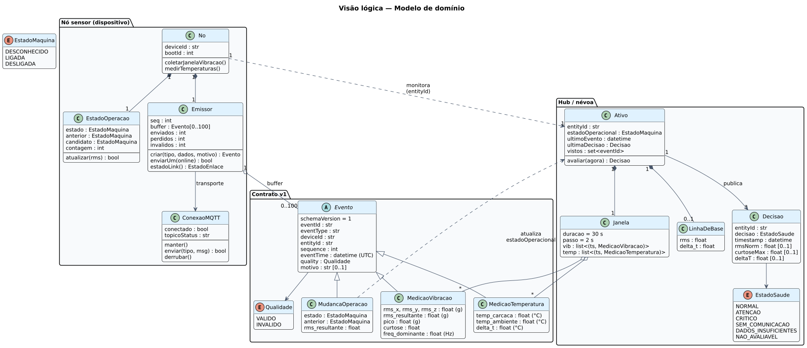
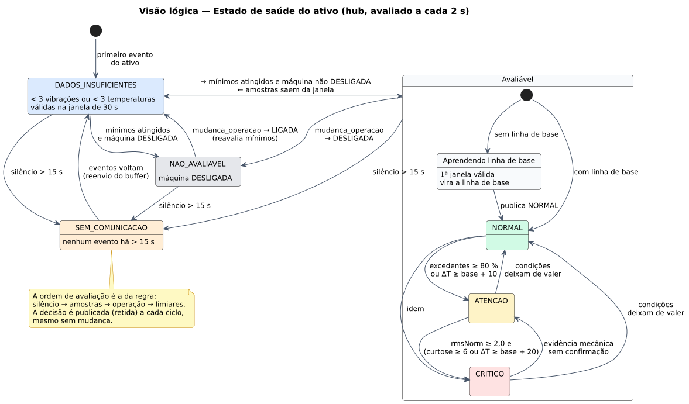
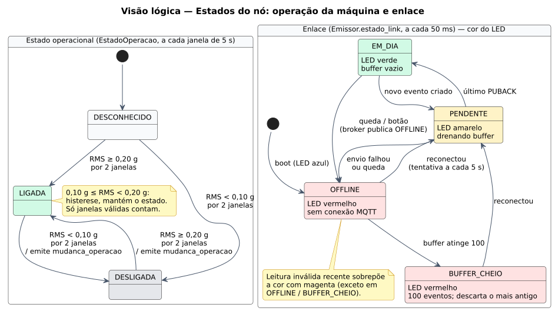

# Visão lógica

**Propósito:** descrever os conceitos do domínio, suas responsabilidades e os estados pelos quais passam, independentemente de onde ou como executam.

**Público:** analistas e desenvolvedores.

## Modelo de domínio

O modelo se divide em três grupos, que coincidem com o contínuo dispositivo → névoa:

### Nó sensor

| Classe | Responsabilidade | Implementação |
|---|---|---|
| `No` | Coleta janelas de vibração (64 amostras, ~100 Hz) e temperaturas; calcula indicadores; valida. | `publisher/main.py`, `publisher/sensores.py` |
| `EstadoOperacao` | Decide se a máquina está `LIGADA` ou `DESLIGADA` com histerese e persistência. | `publisher/main.py` |
| `Emissor` | Monta eventos no contrato v1, numera (`seq`), mantém o buffer FIFO e os contadores `enviados`, `perdidos` e `invalidos`. | `publisher/evento.py` |
| `ConexaoMQTT` | Mantém a conexão, publica com QoS 1, registra o last will, reconecta a cada 5 s. | `publisher/evento.py` |

### Contrato v1

`Evento` é a unidade de comunicação entre nó e hub. É **imutável** depois de criado, e o seu `eventTime` é sempre o instante da medição, mesmo quando é reenviado do buffer. Há três especializações:

| Tipo | Fenômeno | Cadência |
|---|---|---|
| `MedicaoVibracao` | rápido, impulsivo (desbalanceamento, desalinhamento, rolamento) | 5 s |
| `MedicaoTemperatura` | lento, inércia térmica (atrito, lubrificação, sobrecarga) | 2 s |
| `MudancaOperacao` | contexto: valida se a regra se aplica | por exceção |

A `Qualidade` (`VALIDO`/`INVALIDO` + `motivo`) é decidida **no nó**, que conhece a leitura anterior e a física do sensor. Uma leitura inválida é **publicada, não descartada**, para que a falha do sensor fique visível. As regras de validação estão em [`requisitos.md` §3.1.1](../requisitos.md#311-regras-de-validação-no-nó).

Identidade e idempotência: `eventId = deviceId-bootId-sequence`, com `bootId` = horário NTP no boot. O `eventId` é único mesmo depois de reinícios, e é a chave de deduplicação do hub.

### Hub / névoa

| Classe | Responsabilidade |
|---|---|
| `Ativo` | Agrega todo o estado de uma máquina (`entityId`): estado operacional, último evento, última decisão e conjunto de `eventId` vistos. |
| `Janela` | Listas de `(eventTime, data)` por fluxo, podadas para os últimos 30 s **pelo tempo do evento**. |
| `LinhaDeBase` | RMS e ΔT de referência, aprendidos na primeira janela válida. |
| `Decisao` | Saída publicada a cada 2 s: estado de saúde + métricas (`rmsNorm`, `curtoseMax`, `deltaT`). |

## Estado de saúde do ativo

O hub avalia cada ativo a cada 2 s. As condições são testadas **nesta ordem**, e a primeira que vale define o estado:

1. **Silêncio:** sem eventos há > 15 s → `SEM_COMUNICACAO`. O silêncio nunca é lido como normalidade.
2. **Amostras:** < 3 vibrações ou < 3 temperaturas válidas → `DADOS_INSUFICIENTES`.
3. **Operação:** máquina `DESLIGADA` → `NAO_AVALIAVEL`.
4. **Linha de base:** se ainda não existe, a janela atual vira a base → `NORMAL`.
5. **Limiares** (regra de degradação sustentada):
   - `CRITICO`: evidência mecânica (`rmsNorm ≥ 2,0`) **e** confirmação (curtose ≥ 6 **ou** ΔT ≥ base + 20 °C).
   - `ATENCAO`: vibração alta persistente (≥ 80 % dos eventos > 1,5 × base) **ou** aquecimento (ΔT ≥ base + 10 °C).
   - `NORMAL`: caso contrário.

**Por que essa regra:** uma leitura alta isolada pode ser transiente de partida ou impacto na estrutura. Por isso se usa a **mediana** do RMS na janela (robusta a picos) e se exige **confirmação por um segundo indicador** para o estado crítico, o que reduz falsos positivos (o risco secundário citado em [`README.md`](../../README.md), Q5).

| Estado | Cor no dashboard | Métricas publicadas |
|---|---|---|
| `NORMAL` | verde | sim (exceto na janela de aprendizado) |
| `ATENCAO` | amarelo | sim |
| `CRITICO` | vermelho, pulsante | sim |
| `SEM_COMUNICACAO` | laranja | não |
| `DADOS_INSUFICIENTES` | azul | não |
| `NAO_AVALIAVEL` | cinza | não |

## Estados do nó

O nó tem duas máquinas de estado independentes:

- **Estado operacional** (`EstadoOperacao`): os limiares de 0,20 g (liga) e 0,10 g (desliga) formam uma **histerese**, e a mudança só é aceita após **2 janelas consecutivas** com o mesmo alvo. Isso evita que oscilações perto do limiar gerem uma rajada de `mudanca_operacao`. Só janelas válidas atualizam o estado.
- **Enlace** (`Emissor.estado_link`): é derivado do buffer e da conexão a cada laço de 50 ms e se reflete diretamente no LED RGB. Uma leitura inválida recente sobrepõe a cor com magenta, exceto quando o enlace está vermelho.

## Diferenças em relação à arquitetura-alvo

| Aspecto | Protótipo | Alvo (`atv02.md`) |
|---|---|---|
| Linha de base | única, aprendida uma vez | por regime de operação (`freq_dominante`), reajustada após intervenção |
| Janela / passo | 30 s / 2 s | 2 min / 10 s (bancada); 30 min / 5 min (produção) |
| Mínimo de amostras | 3 / 3 | 12 vib / 30 temp (bancada) |
| ΔT agregado | média das 3 últimas | média da janela |
| Eventos atrasados | podados se fora da janela | marca d'água, retificação com `window_id` |
| Falha de um fluxo | `DADOS_INSUFICIENTES` | degradação parcial (avalia pelo fluxo restante) |
| LED do nó | estado do enlace | cor da decisão do hub |
