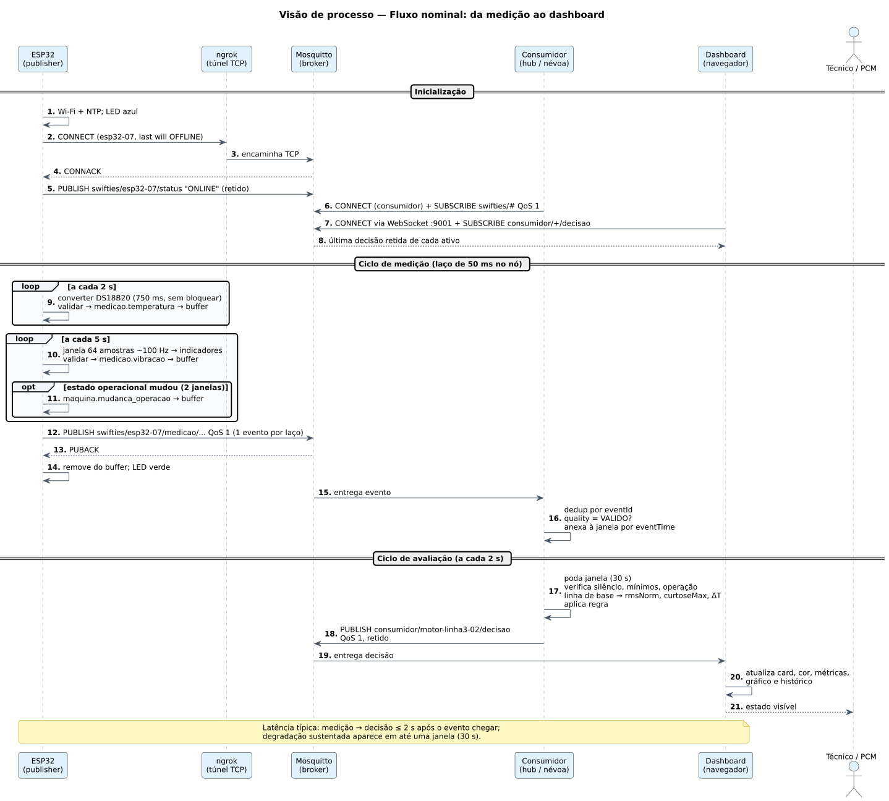
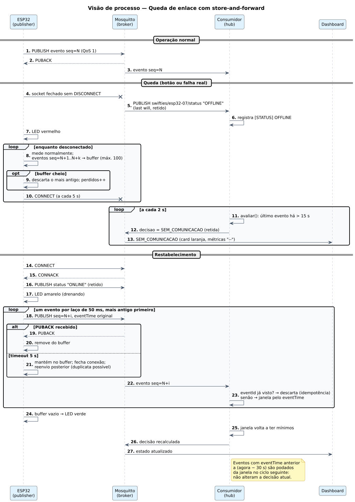
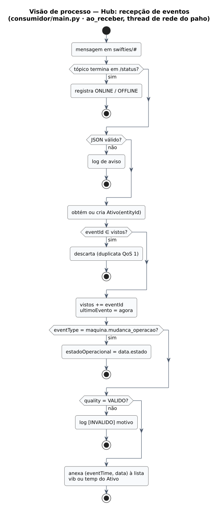
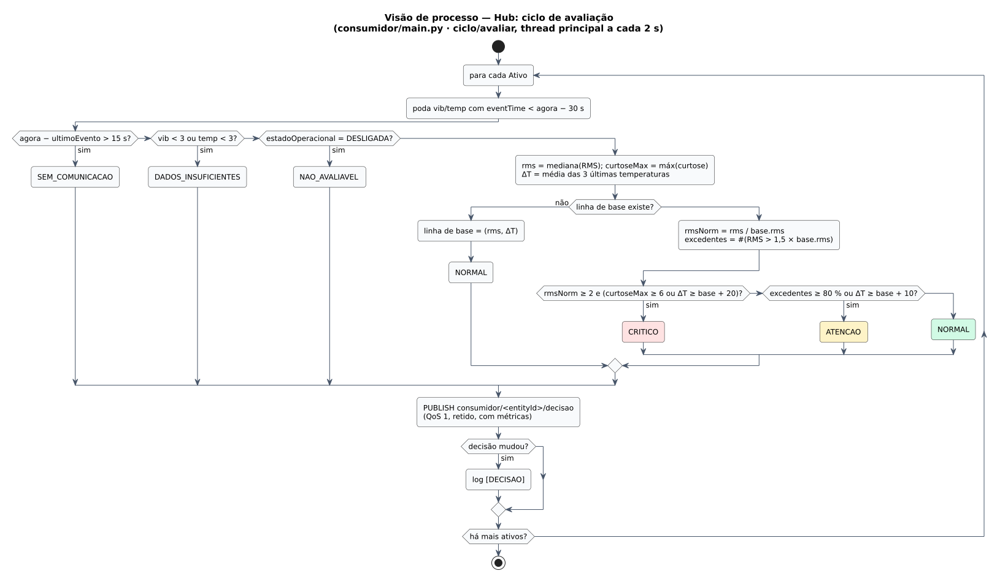
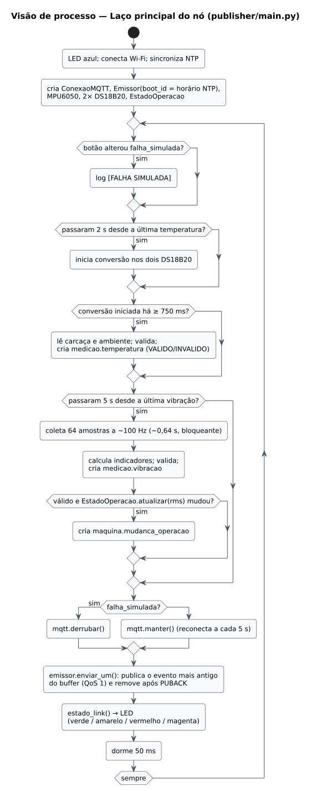

# Visão de processo

**Propósito:** descrever o comportamento dinâmico: quais fluxos de execução existem, como se comunicam, com que cadência e como reagem a falhas.

**Público:** integradores, testadores e quem for depurar o sistema.

## Processos e threads

| Processo | Onde | Fluxo de execução | Cadência |
|---|---|---|---|
| Laço do nó | ESP32 (MicroPython) | 1 laço cooperativo + interrupção do botão | 50 ms (temperatura 2 s, vibração 5 s) |
| Mosquitto | container | event loop do broker | — |
| Consumidor | container Python | thread de rede do paho (`loop_start`) + thread principal de avaliação | avaliação a cada 2 s |
| Dashboard | navegador | event loop JS (callbacks MQTT.js) + `setInterval` | verificação de desatualização a cada 1 s |

Toda a comunicação entre processos é **assíncrona, por publish/subscribe MQTT**. Nenhum componente chama outro diretamente, e o broker é o único ponto de encontro. Assim, cada parte pode reiniciar de forma independente.

## Fluxo nominal

Pontos de atenção:

- **Um evento por laço.** O nó publica no máximo um evento do buffer a cada 50 ms, o que limita o tempo em que o laço fica bloqueado esperando o PUBACK (até 5 s de timeout).
- **Conversão de temperatura não bloqueante.** O nó dispara a conversão dos DS18B20 e lê 750 ms depois, sem dormir.
- **Coleta de vibração bloqueante.** São ~0,64 s a cada 5 s. O botão usa interrupção, então nenhum toque se perde.
- **Decisão retida.** O consumidor publica a decisão a cada ciclo, mesmo sem mudança. Com `retain`, um dashboard aberto mais tarde recebe o último estado na hora.

## Queda de enlace com store-and-forward

Garantias deste fluxo:

| Garantia | Mecanismo |
|---|---|
| Nenhuma perda dentro da capacidade | buffer de 100 eventos (~140 s na cadência atual); remoção só após PUBACK |
| Ordem preservada | FIFO: o mais antigo é enviado primeiro |
| Sem processamento duplicado | QoS 1 pode reentregar; o hub descarta `eventId` já visto |
| Silêncio visível | last will `OFFLINE` + `SEM_COMUNICACAO` após 15 s + card desatualizado após 8 s |
| Correção temporal | eventos reenviados mantêm o `eventTime` original e entram na janela pelo instante em que foram medidos |

**Limitação:** eventos reenviados com `eventTime` anterior a `agora − 30 s` são podados no ciclo seguinte. Eles não são processados nem registrados. A arquitetura-alvo trata esse caso com marca d'água e gravação como `atrasado` (RP-04).

## Hub: recepção de eventos

Roda na thread de rede do paho, a cada mensagem. A ordem dos filtros importa:

1. A **deduplicação vem antes** de tudo, para que uma `mudanca_operacao` reentregue não seja aplicada duas vezes.
2. `ultimoEvento` é atualizado para **qualquer** evento novo, inclusive os inválidos: um nó que só envia leituras inválidas está vivo e não deve aparecer como `SEM_COMUNICACAO`.
3. `mudanca_operacao` é aplicada antes do teste de qualidade, porque carrega contexto e não uma medição.

## Hub: ciclo de avaliação

Roda na thread principal, a cada `PASSO_S = 2 s`, para todos os ativos conhecidos. O detalhamento da regra está na [visão lógica](02-visao-logica.md#estado-de-saúde-do-ativo).

> **Concorrência:** as duas threads compartilham o dicionário `ativos` e as listas `vib`/`temp` sem lock. O GIL do CPython torna seguras as operações individuais (`append`, reatribuição de lista), e o pior caso é um evento entrar na janela um ciclo depois. Para mais ativos ou outro runtime, seria preciso um lock por ativo ou uma fila entre as threads.

## Laço principal do nó

## Latências e cadências

| Trecho | Valor no protótipo |
|---|---|
| Medição de temperatura | a cada 2 s (+ 750 ms de conversão) |
| Medição de vibração | a cada 5 s (janela de 0,64 s) |
| Nó → broker | ≤ 50 ms de espera no buffer + RTT do túnel ngrok (centenas de ms) |
| Avaliação no hub | a cada 2 s |
| Detecção de degradação sustentada | ≤ 30 s (uma janela) |
| Detecção de silêncio | 15 s (hub); 8 s (dashboard, card desatualizado) |
| Reconexão do nó | tentativa a cada 5 s |
