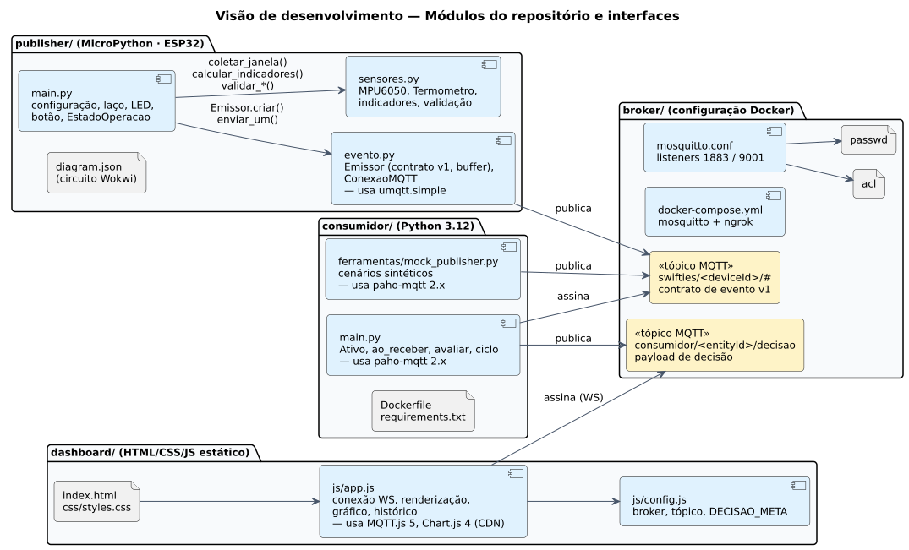

# Visão de desenvolvimento

**Propósito:** descrever como o código está organizado no repositório, as dependências entre módulos e as interfaces que os separam.

**Público:** desenvolvedores.

## Componentes e interfaces



Os quatro diretórios de primeiro nível são **componentes independentes**. Cada um tem seu README, seu runtime e (exceto o nó) seu `docker-compose.yml`. Nenhum importa código de outro: o acoplamento é só pelos **tópicos MQTT e seus contratos JSON**, que são a verdadeira interface do sistema.

| Componente | Linguagem / runtime | Responsabilidade | Depende de |
|---|---|---|---|
| [`publisher/`](../../publisher/) | MicroPython (ESP32, Wokwi) | nó sensor | `umqtt.simple`, `machine`, `onewire`, `ds18x20`, `ntptime` |
| [`broker/`](../../broker/) | configuração (Mosquitto 2 + ngrok) | transporte, autenticação, autorização | imagens `eclipse-mosquitto:2`, `ngrok/ngrok` |
| [`consumidor/`](../../consumidor/) | Python 3.12 | hub / névoa: decisão | `paho-mqtt` 2.x |
| [`dashboard/`](../../dashboard/) | HTML + CSS + JS (ES6), Nginx | visualização | MQTT.js 5.10.1, Chart.js 4.4.1 (CDN) |

## Módulos do nó

O nó separa três preocupações:

| Módulo | Preocupação | Conteúdo |
|---|---|---|
| `main.py` | **orquestração**: configuração, laço, LED, botão, estado operacional | constantes de cadência e limiares; `EstadoOperacao`; `tratar_*` |
| `sensores.py` | **física**: drivers e processamento de sinal | `MPU6050`, `Termometro`, `coletar_janela`, `calcular_indicadores`, `validar_*`; flag `SIMULAR_VIBRACAO` |
| `evento.py` | **comunicação**: contrato e transporte | `Emissor` (contrato v1, buffer), `ConexaoMQTT` |

O `Emissor` recebe o transporte por injeção (`transporte=mqtt.enviar`), então pode ser testado com um transporte falso.

## Interfaces (contratos entre componentes)

| Interface | Produtor → consumidor | Definição |
|---|---|---|
| `swifties/<deviceId>/{medicao/vibracao, medicao/temperatura, maquina/mudanca_operacao}` | nó / mock → consumidor | contrato de evento v1: [`requisitos.md` RI-01](../requisitos.md#ri-01--contrato-de-evento-v1-nó--hub) |
| `swifties/<deviceId>/status` | nó / broker (last will) → consumidor | `ONLINE` / `OFFLINE`, retido |
| `consumidor/<entityId>/decisao` | consumidor → dashboard | payload de decisão: [`requisitos.md` RI-03](../requisitos.md#ri-03--payload-de-decisão-hub--dashboard) |

O broker não tem código: o que ele "implementa" é a **política** sobre essas interfaces, em `mosquitto.conf` (listeners), `passwd` (quem existe) e `acl` (quem lê e escreve cada tópico).

| Usuário | Lê | Escreve |
|---|---|---|
| `esp32-07` | — | `swifties/esp32-07/#` |
| `consumidor` | `swifties/#` | `consumidor/#` |
| `admin` | `#` | `#` |

> O dashboard usa hoje o usuário `admin`, cuja credencial fica exposta no JavaScript do navegador. Pelo princípio do menor privilégio (RNF-05), o recomendado é um usuário `dashboard` com leitura apenas em `consumidor/#`.

## Configuração

Os parâmetros que mudam entre bancada e produção são constantes nomeadas ou variáveis de ambiente, nunca números soltos no código (RNF-09):

| Onde | Parâmetros |
|---|---|
| `publisher/main.py` | `CADENCIA_VIB_MS`, `CADENCIA_TEMP_MS`, `AMOSTRAS`, `LIGA_RMS_G`, `DESLIGA_RMS_G`, `PERSISTENCIA`, `MQTT_*`, `BUFFER_MAX` |
| `publisher/sensores.py` | faixas de validação, `SIMULAR_VIBRACAO`, `ZONA_MORTA_G`, `AMPLITUDE_MAX_G` |
| `consumidor/main.py` | `JANELA_S`, `PASSO_S`, `MIN_VIB`, `MIN_TEMP`, `SILENCIO_S`, limiares da regra; `MQTT_*` por ambiente (`.env`) |
| `dashboard/js/config.js` | `MQTT_BROKER_URL`, credenciais, `MQTT_TOPIC`, `MAX_PONTOS`, `LIMITE_DESATUALIZADO_MS`, `DECISAO_META` |
| `broker/.env` | `NGROK_AUTHTOKEN` |

## Teste

- **`consumidor/ferramentas/mock_publisher.py`** publica eventos sintéticos no contrato v1 direto no broker local, com cenários para cada ramo da regra (cenário CN-07). Ele usa as credenciais do nó, então também exercita a ACL.
- **Wokwi** é o ambiente de integração do nó, com roteiro de demonstração em [`publisher/README.md`](../../publisher/README.md).
- **Evidências** do dashboard estão em [`dashboard/evidencias/`](../../dashboard/evidencias/).

Não há testes automatizados no repositório. Os candidatos naturais são `avaliar()` do consumidor (função pura sobre `Ativo` + `agora`) e `calcular_indicadores()` / `validar_*()` do nó.

## Documentação

```
docs/
├── README.md               índice
├── requisitos.md           requisitos (SRS)
└── arquitetura/
    ├── README.md           visão geral 4+1
    ├── 01-cenarios.md … 05-visao-fisica.md
    └── diagramas/          *.puml (fonte) + svg/ (renderizado)
```
