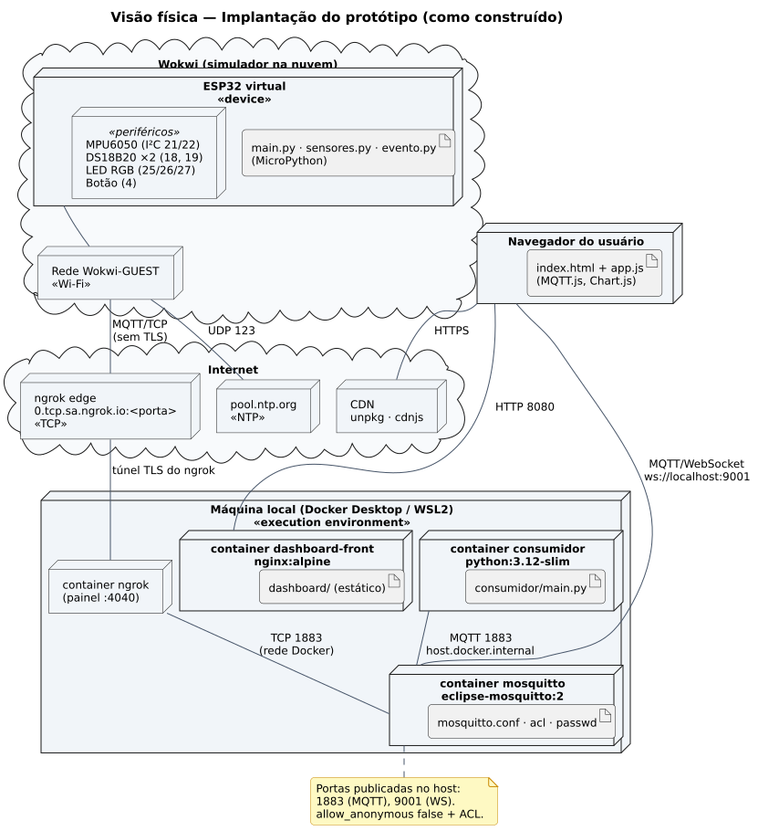
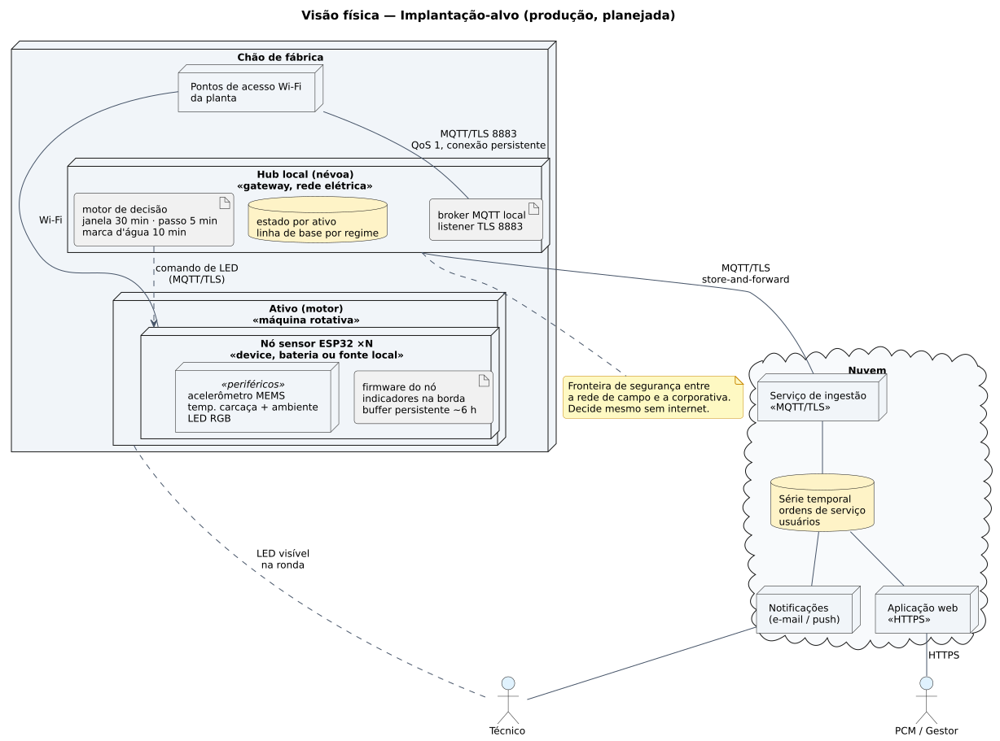

# Visão física

**Propósito:** mapear os elementos de software para os nós físicos ou virtuais onde executam, e descrever os enlaces de rede entre eles.

**Público:** quem implanta e opera o sistema; infraestrutura.

## Implantação do protótipo



| Nó | Executa | Rede |
|---|---|---|
| **ESP32 virtual** (Wokwi) | `publisher/*.py` em MicroPython; periféricos simulados (MPU6050, 2× DS18B20, LED RGB, botão) | Wi-Fi `Wokwi-GUEST` → internet |
| **ngrok edge** (internet) | ponto público `tcp://0.tcp.sa.ngrok.io:<porta>` | túnel até o agente local |
| **Máquina local** (Docker) | containers `ngrok`, `mosquitto`, `consumidor`, `dashboard-front` | portas 1883, 9001, 4040, 8080 publicadas no host |
| **Navegador** | `index.html` + `app.js` | HTTP :8080 (Nginx); WebSocket :9001 (Mosquitto); HTTPS (CDN) |

Enlaces e protocolos:

| De → para | Protocolo | Porta | Segurança |
|---|---|---|---|
| ESP32 → ngrok edge → mosquitto | MQTT 3.1.1 sobre TCP | pública variável → 1883 | usuário/senha; **sem TLS** de ponta a ponta |
| consumidor → mosquitto | MQTT | 1883 via `host.docker.internal` | usuário/senha |
| navegador → mosquitto | MQTT sobre WebSocket | 9001 | usuário/senha; **sem TLS** (`ws://`) |
| navegador → Nginx | HTTP | 8080 | — |
| ESP32 → NTP | NTP/UDP | 123 | — |

Por que o túnel: o simulador Wokwi roda na nuvem e só alcança endereços públicos. O ngrok expõe o 1883 local sem abrir portas no roteador. O custo é que o endereço muda a cada reinício do túnel, e é preciso atualizar `MQTT_HOST`/`MQTT_PORTA` em `publisher/main.py` (restrição C-03).

### Subir o ambiente

```bash
cd broker      && cp .env.example .env && docker compose up -d   # mosquitto + ngrok
cd consumidor  && cp .env.example .env && docker compose up -d --build
cd dashboard   && docker compose up -d                            # http://localhost:8080
docker compose -f broker/docker-compose.yml logs ngrok | grep -o 'tcp://[^ ]*'
# → copiar host:porta para publisher/main.py e iniciar a simulação no Wokwi
```

## Implantação-alvo



Arquitetura de produção descrita em [`README.md`](../../README.md) (Q3, Q6) e [`atv02.md`](../../atv02.md) (Q10–Q12). Ainda não foi implementada.

| Camada | Nó | Responsabilidades | Estado mantido |
|---|---|---|---|
| **Dispositivo** | ESP32 fixado em cada ativo, a bateria ou com fonte local | amostragem, indicadores, ligado/desligado, eventos, LED | buffer de eventos não confirmados (~6 h, persistente), `seq`, estado do LED |
| **Névoa** | hub local alimentado pela rede elétrica | broker MQTT/TLS, validação, deduplicação, janela, linha de base, decisão, comando do LED; fronteira de segurança campo ↔ corporativa | janelas por tipo, linha de base por regime, estado operacional, última decisão |
| **Nuvem** | serviços gerenciados | ingestão, série temporal, dashboard, notificações, ordens de serviço, reajuste da linha de base | histórico, ordens de serviço, usuários |

## Do protótipo à produção

| Aspecto | Protótipo | Alvo | Requisito |
|---|---|---|---|
| Hospedagem do nó | Wokwi (simulado) | ESP32 físico na máquina | — |
| Rede do nó | internet + ngrok | Wi-Fi da planta, direto ao hub | — |
| Cifragem | nenhuma | MQTT/TLS 8883; HTTPS | RP-01 |
| Local da decisão | consumidor em container na máquina do desenvolvedor | hub dedicado na planta | — |
| Camada de nuvem | inexistente: o dashboard lê direto do broker | ingestão + série temporal + aplicação web | RP-05 |
| LED do nó | estado do enlace | cor da decisão, comandada pelo hub | RP-02 |
| Buffer do nó | 100 eventos em RAM | ~6 h persistente | RP-08 |
| Alimentação | USB (simulado) | bateria com deep sleep ou fonte local | RNF-15 |
| Cadência | vib. 5 s / temp. 2 s | vib. 10 min / temp. 1 min, adaptativa perto do limiar | RP-06, RP-09 |

**Risco principal** (Wi-Fi, [`README.md`](../../README.md) Q5): associação ao AP e handshake TLS mantêm o rádio ativo por segundos a cada ciclo. A mitigação é uma conexão MQTT persistente (um único handshake), IP estático, processamento na borda, envios agrupados e alimentação local onde houver tomada.
