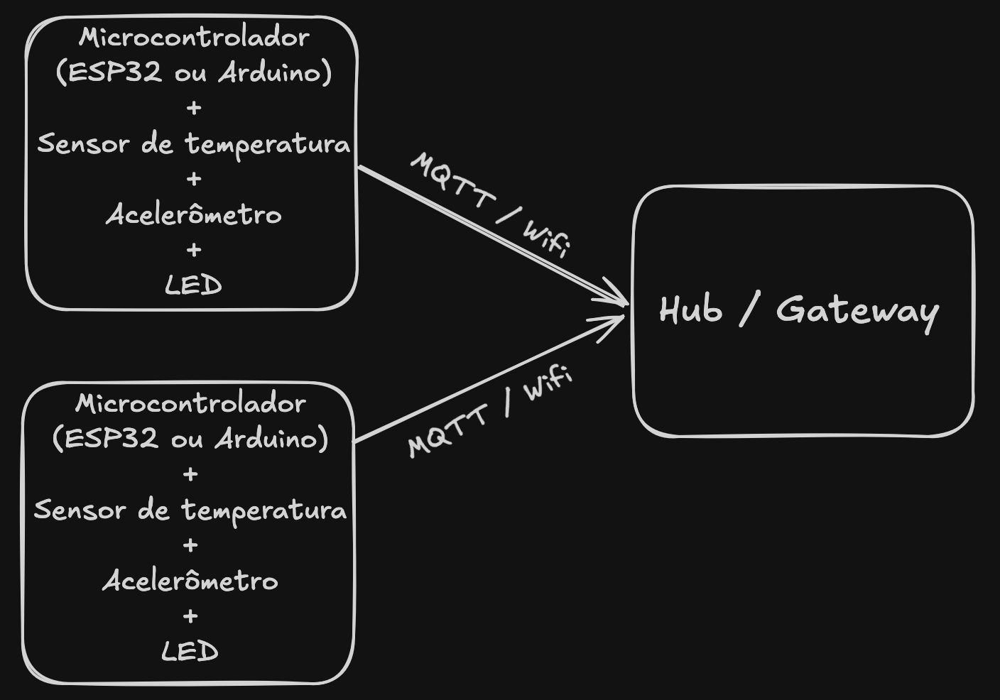

# Documento de Requisitos — Manutenção Preditiva de Ativos Industriais

**Sistemas Ubíquos** | Integrantes: Guilherme Iago, João Victor Lemes, Marcos Sousa, Yasmin Moura

Estrutura inspirada na ISO/IEC/IEEE 29148 (especificação de requisitos de software). Os requisitos descrevem o **protótipo implementado** neste repositório e, separadamente, a **arquitetura-alvo** de produção descrita em [`README.md`](../README.md) e [`atv02.md`](../atv02.md).

---

## 1. Introdução

### 1.1 Propósito

Especificar o comportamento esperado do sistema de monitoramento de vibração e temperatura de máquinas rotativas, servindo de referência para implementação, testes e para a documentação arquitetural 4+1 em [`arquitetura/`](arquitetura/README.md).

### 1.2 Escopo

O sistema mede vibração e temperatura de um ativo com um nó sensor (ESP32), extrai indicadores na borda, transporta eventos por MQTT até um hub local (névoa) que decide o estado de saúde do ativo e publica a decisão para uma interface web em tempo real.

**Dentro do escopo do protótipo:** nó sensor simulado no Wokwi, broker Mosquitto com autenticação e ACL, túnel ngrok, consumidor Python (hub), dashboard web e gerador de eventos sintéticos.

**Fora do escopo do protótipo (planejado):** TLS, camada de nuvem (histórico, notificações, ordens de serviço), comando do LED do nó pela decisão do hub, marca d'água para eventos atrasados, amostragem adaptativa e operação a bateria.

### 1.3 Definições e siglas

| Termo | Definição |
|---|---|
| **Ativo** | Máquina rotativa monitorada (ex.: `motor-linha3-02`), identificada por `entityId`. |
| **Nó** | Dispositivo sensor fixado ao ativo (ESP32), identificado por `deviceId`. |
| **Hub / névoa** | Processamento local entre o nó e a nuvem; aqui, o `consumidor`. |
| **RMS** | Valor eficaz da aceleração na janela (g). `rms_resultante` combina os três eixos. |
| **Curtose** | Momento estatístico de 4ª ordem; valores altos indicam impactos (ex.: defeito de rolamento). |
| **ΔT (`delta_t`)** | Diferença entre temperatura da carcaça e temperatura ambiente (°C). |
| **Linha de base** | RMS e ΔT de referência do ativo, contra os quais as leituras são normalizadas. |
| **RMS normalizado** | Mediana do RMS na janela dividida pelo RMS da linha de base. |
| **Janela** | Intervalo de tempo (pelo tempo do evento) sobre o qual a regra de decisão é avaliada. |
| **QoS 1** | Nível MQTT "pelo menos uma vez": o emissor reenvia até receber PUBACK; pode gerar duplicatas. |
| **Last will** | Mensagem que o broker publica em nome de um cliente que caiu sem DISCONNECT. |
| **Store-and-forward** | Guardar eventos localmente enquanto o enlace está fora e reenviar ao restabelecer. |
| **PCM** | Planejamento e Controle da Manutenção. |
| **ACL** | Lista de controle de acesso a tópicos no broker. |

### 1.4 Referências

- [`README.md`](../README.md): Atividade 01, compreensão do problema e modelagem.
- [`atv02.md`](../atv02.md): Atividade 02, eventos, processamento temporal e distribuição.
- [`publisher/README.md`](../publisher/README.md), [`broker/README.md`](../broker/README.md), [`consumidor/README.md`](../consumidor/README.md), [`dashboard/README.md`](../dashboard/README.md).
- Visões arquiteturais: [`arquitetura/README.md`](arquitetura/README.md).

### 1.5 Convenções

- **IDs:** `RF-xx` (funcional), `RNF-xx` (não funcional), `RI-xx` (interface), `RP-xx` (planejado, arquitetura-alvo).
- **Prioridade (MoSCoW):** **M** = must, **S** = should, **C** = could, **W** = won't (nesta versão).
- **Situação:** ✅ implementado · 🟡 parcial · ⬜ planejado.

---

## 2. Descrição geral

### 2.1 Perspectiva do produto

Sistema IoT em três camadas (dispositivo → névoa → nuvem), com a decisão na névoa para não depender do link de internet da planta. No protótipo, a camada de nuvem é substituída por um dashboard que consome a decisão diretamente do broker.



### 2.2 Partes interessadas e usuários

| Parte interessada | Necessidade | Como o sistema atende |
|---|---|---|
| **Técnico de manutenção** | Saber o que inspecionar agora, em campo | LED no ativo; estado por ativo no dashboard |
| **Planejador / PCM** | Saber quando programar a parada | Tendência de RMS normalizado e ΔT no gráfico; histórico de mudanças de estado |
| **Gestor** | Visão do risco de parada | Painel com todos os ativos e seus estados |
| **Equipe de infraestrutura** | Saber quando um nó ou o enlace falhou | Estado `SEM_COMUNICACAO`, status `ONLINE`/`OFFLINE`, LED do nó |
| **Equipe de desenvolvimento** | Testar sem hardware | Simulação Wokwi e `mock_publisher.py` |

### 2.3 Ambiente operacional

- **Nó:** ESP32 com MicroPython, simulado no Wokwi (rede `Wokwi-GUEST`), com MPU6050 (I²C), dois DS18B20 (1-Wire), LED RGB e botão.
- **Broker:** Eclipse Mosquitto 2 em Docker; MQTT em `1883`, WebSocket em `9001`.
- **Túnel:** ngrok TCP expondo `1883` para o Wokwi.
- **Consumidor:** Python 3.12 + `paho-mqtt` 2.x em Docker.
- **Dashboard:** HTML/CSS/JS estático servido por Nginx (`8080`); MQTT.js 5 e Chart.js 4 por CDN; navegador moderno.

### 2.4 Restrições

| ID | Restrição |
|---|---|
| C-01 | O Wokwi só oferece valores estáticos para o MPU6050; a oscilação é sintetizada sobre a leitura real. |
| C-02 | O Wokwi alcança apenas endereços públicos, por isso o broker local precisa de um túnel (ngrok). |
| C-03 | O endereço do ngrok gratuito muda a cada reinício e precisa ser atualizado em `publisher/main.py`. |
| C-04 | Sem TLS no protótipo: credenciais trafegam em texto claro pelo túnel. |
| C-05 | Buffer do nó em RAM: um reinício perde os eventos pendentes. |
| C-06 | Credenciais fictícias versionadas no repositório (trabalho acadêmico). |

### 2.5 Premissas e dependências

- O relógio do nó é sincronizado por NTP no boot; sem NTP, `eventTime` perde a referência real.
- O ativo está na condição saudável durante os primeiros ~15 s após a primeira janela válida, que viram a linha de base.
- Um ativo é monitorado por um único nó.

---

## 3. Requisitos funcionais

### 3.1 Nó sensor (`publisher/`)

| ID | Requisito | Pri. | Sit. | Critério de aceitação |
|---|---|---|---|---|
| RF-01 | O nó deve coletar uma janela de vibração triaxial de 64 amostras a ~100 Hz a cada 5 s. | M | ✅ | Um evento `medicao.vibracao` a cada ~5 s no `mosquitto_sub`. |
| RF-02 | O nó deve calcular, por janela, `rms_x`, `rms_y`, `rms_z`, `rms_resultante` (sem a gravidade), `pico`, `curtose` e `freq_dominante`. | M | ✅ | Campos presentes em `data`; `rms_resultante ≈ 0,707 × A` para deslocamento `A`. |
| RF-03 | O nó deve medir a temperatura da carcaça e a ambiente a cada 2 s, sem bloquear o laço durante a conversão (750 ms), e calcular `delta_t`. | M | ✅ | Um evento `medicao.temperatura` a cada ~2 s com `delta_t = temp_carcaca − temp_ambiente`. |
| RF-04 | O nó deve validar cada leitura por faixa física e coerência entre campos (tabela em §3.1.1) e publicar a leitura inválida com `quality: "INVALIDO"` e `motivo`, em vez de descartá-la. | M | ✅ | Roteiro de demonstração, passos 5 e 6 (`salto_de_temperatura`, `mpu_fora_de_faixa`). |
| RF-05 | O nó deve classificar o estado operacional do ativo (`LIGADA` se RMS ≥ 0,20 g, `DESLIGADA` se < 0,10 g, histerese entre os dois), confirmar a mudança após 2 janelas consecutivas e emitir `maquina.mudanca_operacao`. | M | ✅ | Roteiro, passos 1 e 2. |
| RF-06 | O nó deve gerar todos os eventos no contrato v1 (RI-01), com `eventId = deviceId-bootId-sequence` único entre reinícios e `eventTime` UTC do instante da medição. | M | ✅ | Eventos reenviados do buffer mantêm o `eventTime` original. |
| RF-07 | O nó deve publicar cada evento com QoS 1 no tópico `swifties/<deviceId>/<eventType com "." → "/">`. | M | ✅ | Tópicos conforme RI-02. |
| RF-08 | O nó deve manter um buffer FIFO de até 100 eventos; um evento só sai do buffer após o PUBACK. Com o buffer cheio, o mais antigo é descartado e contado em `perdidos`. | M | ✅ | Roteiro, passo 3: eventos atrasados chegam em ordem de `sequence`. |
| RF-09 | O nó deve tentar reconectar ao broker a cada 5 s enquanto desconectado. | M | ✅ | Roteiro, passo 4. |
| RF-10 | O nó deve publicar `ONLINE` (retido) em `swifties/<deviceId>/status` ao conectar e registrar `OFFLINE` como last will. | M | ✅ | `OFFLINE` aparece no `mosquitto_sub` ao derrubar o enlace sem DISCONNECT. |
| RF-11 | O nó deve sinalizar no LED RGB: azul (inicializando), verde (em dia), amarelo (drenando buffer), vermelho (desconectado ou buffer cheio), magenta (última leitura inválida). | S | ✅ | Observação visual no Wokwi. |
| RF-12 | O nó deve permitir simular uma falha de enlace por botão (fechar o socket sem DISCONNECT) e restabelecê-lo com novo toque. | S | ✅ | Roteiro, passo 3. |

#### 3.1.1 Regras de validação no nó

| Fluxo | Inválido quando | `motivo` |
|---|---|---|
| Vibração | MPU6050 não responde | `mpu_sem_resposta` |
| Vibração | magnitude real fora de 0,05–8 g | `mpu_fora_de_faixa` |
| Vibração | `pico < rms_resultante` | `pico_menor_que_rms` |
| Vibração | `rms_resultante > 50 g` | `rms_fora_de_faixa` |
| Vibração | curtose fora de 1–50 | `curtose_fora_de_faixa` |
| Temperatura | sensor ausente | `sensor_carcaca_ausente` / `sensor_ambiente_ausente` |
| Temperatura | fora de −10–150 °C | `temperatura_fora_de_faixa` |
| Temperatura | ambiente ≥ carcaça + 5 °C | `ambiente_maior_que_carcaca` |
| Temperatura | variação > 5 °C/min desde a leitura anterior | `salto_de_temperatura` |

### 3.2 Broker (`broker/`)

| ID | Requisito | Pri. | Sit. | Critério de aceitação |
|---|---|---|---|---|
| RF-13 | O broker deve recusar conexões anônimas e autenticar clientes por usuário e senha (hash em `passwd`). | M | ✅ | `mosquitto_sub` sem `-u/-P` é recusado. |
| RF-14 | O broker deve aplicar ACL por usuário: `esp32-07` só escreve em `swifties/esp32-07/#`; `consumidor` lê `swifties/#` e escreve em `consumidor/#`; `admin` lê e escreve em `#`. | M | ✅ | Publicação do nó fora do seu prefixo não é entregue. |
| RF-15 | O broker deve oferecer listener WebSocket na porta 9001 para o dashboard. | M | ✅ | Dashboard conecta em `ws://localhost:9001`. |
| RF-16 | O broker deve ser alcançável pelo Wokwi por túnel TCP (ngrok) para a porta 1883. | M | ✅ | Endereço `tcp://*.ngrok.io:<porta>` nos logs do ngrok. |

### 3.3 Hub / consumidor (`consumidor/`)

| ID | Requisito | Pri. | Sit. | Critério de aceitação |
|---|---|---|---|---|
| RF-17 | O consumidor deve assinar `swifties/#` com QoS 1 e manter estado separado por `entityId`. | M | ✅ | Dois ativos no mock geram dois cards. |
| RF-18 | O consumidor deve descartar eventos com `eventId` já processado (idempotência frente a reenvios QoS 1). | M | ✅ | `mock_publisher --cenario duplicata` não altera a decisão. |
| RF-19 | O consumidor deve excluir da janela eventos com `quality ≠ VALIDO` e registrá-los. | M | 🟡 | `--cenario invalido` gera log `[INVALIDO]`. *Falta contar falhas por nó (`atv02.md`, Q4).* |
| RF-20 | O consumidor deve atualizar o estado operacional do ativo a partir de `maquina.mudanca_operacao`. | M | ✅ | Log `[OPERACAO]`. |
| RF-21 | O consumidor deve manter, por ativo e por fluxo, uma janela deslizante de 30 s indexada pelo **tempo do evento**, reavaliada a cada 2 s. | M | ✅ | Eventos reenviados do buffer entram na janela pelo seu `eventTime`. |
| RF-22 | O consumidor deve aprender a linha de base (mediana do RMS e ΔT médio) na primeira janela válida do ativo. | M | ✅ | Primeira decisão avaliável é `NORMAL`. |
| RF-23 | O consumidor deve classificar o ativo pela regra de degradação sustentada (§3.3.1). | M | ✅ | `--cenario atencao` → `ATENCAO`; `--cenario critico` → `CRITICO`. |
| RF-24 | O consumidor deve emitir `SEM_COMUNICACAO` após 15 s sem eventos do ativo, `DADOS_INSUFICIENTES` com menos de 3 amostras válidas de cada fluxo na janela, e `NAO_AVALIAVEL` com a máquina `DESLIGADA`. | M | ✅ | `--cenario sem_comunicacao` e `--cenario desligada`. |
| RF-25 | O consumidor deve publicar a decisão atual de cada ativo a cada 2 s em `consumidor/<entityId>/decisao` (QoS 1, retida), com as métricas quando avaliáveis. | M | ✅ | Dashboard aberto depois mostra o último estado imediatamente. |

#### 3.3.1 Regra de decisão

Com `base` = linha de base do ativo, `rms_norm` = mediana(RMS) / `base.rms`, `curtose_max` = máximo da curtose na janela, `delta_t` = média das 3 últimas temperaturas e `excedentes` = nº de eventos de vibração na janela com RMS > 1,5 × `base.rms`:

| Decisão | Condição (avaliada nesta ordem) |
|---|---|
| `SEM_COMUNICACAO` | nenhum evento há mais de 15 s |
| `DADOS_INSUFICIENTES` | < 3 vibrações ou < 3 temperaturas válidas na janela |
| `NAO_AVALIAVEL` | estado operacional `DESLIGADA` |
| `NORMAL` (aprendizado) | ainda sem linha de base: a janela atual vira a linha de base |
| `CRITICO` | `rms_norm ≥ 2,0` **e** (`curtose_max ≥ 6,0` **ou** `delta_t ≥ base.delta_t + 20`) |
| `ATENCAO` | `excedentes ≥ 80 %` dos eventos de vibração da janela **ou** `delta_t ≥ base.delta_t + 10` |
| `NORMAL` | caso contrário |

### 3.4 Dashboard (`dashboard/`)

| ID | Requisito | Pri. | Sit. | Critério de aceitação |
|---|---|---|---|---|
| RF-26 | O dashboard deve conectar ao broker por WebSocket com usuário e senha e assinar `consumidor/+/decisao`. | M | ✅ | Badge "Broker Online". |
| RF-27 | O dashboard deve criar dinamicamente um card por `entityId` recebido. | M | ✅ | Novo ativo no mock gera novo card sem recarregar. |
| RF-28 | O dashboard deve exibir cada decisão com rótulo, cor e classe CSS próprios (`NORMAL` verde, `ATENCAO` amarelo, `CRITICO` vermelho pulsante, `SEM_COMUNICACAO` laranja, `DADOS_INSUFICIENTES` azul, `NAO_AVALIAVEL` cinza). | M | ✅ | Ver evidências em `dashboard/evidencias/`. |
| RF-29 | O dashboard deve exibir RMS normalizado, ΔT e curtose máxima, mostrando `--` quando ausentes. | M | ✅ | Em `SEM_COMUNICACAO` as métricas mostram `--`. |
| RF-30 | O dashboard deve plotar RMS normalizado e ΔT em gráfico de linha com os últimos 90 pontos, colorindo cada ponto pela decisão. | S | ✅ | Gráfico rola após 90 pontos. |
| RF-31 | O dashboard deve listar as últimas 8 mudanças de estado do ativo com horário. | S | ✅ | Lista atualizada só quando a decisão muda. |
| RF-32 | O dashboard deve marcar o card como desatualizado quando não receber mensagem do ativo por mais de 8 s. | S | ✅ | Parar o consumidor esmaece os cards. |
| RF-33 | O dashboard deve indicar o estado da conexão com o broker (online / offline / erro). | S | ✅ | Parar o broker muda o badge. |

### 3.5 Ferramentas de teste

| ID | Requisito | Pri. | Sit. | Critério de aceitação |
|---|---|---|---|---|
| RF-34 | Deve existir um gerador de eventos sintéticos no contrato v1 com os cenários `normal`, `atencao`, `critico`, `desligada`, `invalido`, `duplicata` e `sem_comunicacao`. | S | ✅ | `consumidor/ferramentas/mock_publisher.py --cenario <nome>`. |

---

## 4. Requisitos não funcionais

| ID | Categoria | Requisito | Pri. | Sit. | Verificação |
|---|---|---|---|---|---|
| RNF-01 | Desempenho / latência | Uma degradação sustentada deve refletir no dashboard em até uma janela (≤ 30 s) após começar, e cada decisão deve chegar ao dashboard em até 2 s após calculada. | M | ✅ | Cronometrar `--cenario critico`. |
| RNF-02 | Confiabilidade | Nenhum evento pode se perder em quedas de enlace dentro da capacidade do buffer: 100 eventos ≈ 140 s na cadência do protótipo (0,7 evento/s). | M | ✅ | Roteiro, passos 3 e 4: `perdidos = 0`. |
| RNF-03 | Confiabilidade / idempotência | Reenvios e duplicatas não podem alterar a decisão. | M | ✅ | RF-18. |
| RNF-04 | Observabilidade | Nenhuma falha pode passar em silêncio: leitura inválida é publicada, queda de enlace gera `OFFLINE`, silêncio vira `SEM_COMUNICACAO`, buffer cheio é contado. | M | 🟡 | Eventos atrasados além da janela são podados sem registro (ver RP-04). |
| RNF-05 | Segurança | Todo cliente deve se autenticar e ter o menor privilégio necessário nos tópicos. | M | 🟡 | RF-13/RF-14. *O dashboard usa a credencial `admin` no navegador; o recomendado é um usuário somente leitura em `consumidor/#`.* |
| RNF-06 | Segurança | Credenciais e dados devem trafegar cifrados. | S | ⬜ | Ver RP-01. |
| RNF-07 | Corretude temporal | A janela deve usar o tempo do evento, não o de chegada; o tempo de chegada serve só para detectar silêncio. | M | ✅ | RF-21, RF-24. |
| RNF-08 | Eficiência de rede | O nó deve transmitir apenas indicadores (centenas de bytes por evento), nunca a forma de onda bruta. | M | ✅ | Tamanho dos payloads no `mosquitto_sub`. |
| RNF-09 | Configurabilidade | Cadências, janela, passo, mínimos de amostras e limiares devem ser parâmetros (constantes nomeadas / variáveis de ambiente), com a mesma lógica nos perfis de bancada e produção. | S | ✅ | Constantes no topo de `publisher/main.py`, `publisher/sensores.py` e `consumidor/main.py`. |
| RNF-10 | Implantabilidade | Broker, consumidor e dashboard devem subir cada um com `docker compose up`. | S | ✅ | READMEs dos componentes. |
| RNF-11 | Manutenibilidade | O código do nó deve separar laço/estado (`main.py`), sensoriamento (`sensores.py`) e contrato/transporte (`evento.py`). | S | ✅ | Estrutura de `publisher/`. |
| RNF-12 | Usabilidade | O estado do ativo deve ser legível de relance: código de cores único por decisão, sem precisar ler números. | S | ✅ | RF-28. |
| RNF-13 | Portabilidade | O dashboard deve ser estático e sem framework, executável em qualquer servidor HTTP. | C | ✅ | `python3 -m http.server`. |
| RNF-14 | Escalabilidade de memória | O estado de deduplicação não deve crescer sem limite. | S | ⬜ | *Hoje o conjunto `vistos` cresce indefinidamente; trocar por janela de `eventId` ou maior `sequence` por nó.* |
| RNF-15 | Energia | Em campo, o nó a bateria deve durar meses (deep sleep entre envios, cadência de produção). | C | ⬜ | Fora do protótipo (nó alimentado por USB). |

---

## 5. Interfaces externas

### RI-01 — Contrato de evento v1 (nó → hub)

```json
{
  "schemaVersion": 1,
  "eventId": "esp32-07-1789612330-3",
  "eventType": "medicao.vibracao",
  "deviceId": "esp32-07",
  "entityId": "motor-linha3-02",
  "sequence": 3,
  "eventTime": "2026-09-17T02:32:15Z",
  "quality": "VALIDO",
  "motivo": null,
  "data": { "rms_x": 1.379, "rms_y": 0.011, "rms_z": 0.012, "rms_resultante": 1.379,
            "pico": 1.97, "curtose": 1.5, "freq_dominante": 29.4 }
}
```

| `eventType` | `data` |
|---|---|
| `medicao.vibracao` | `rms_x`, `rms_y`, `rms_z`, `rms_resultante`, `pico` (g), `curtose`, `freq_dominante` (Hz) |
| `medicao.temperatura` | `temp_carcaca`, `temp_ambiente`, `delta_t` (°C) |
| `maquina.mudanca_operacao` | `estado`, `anterior`, `rms_resultante` |

Com `quality: "INVALIDO"`, `motivo` é obrigatório e `data` pode ser `null`.

### RI-02 — Tópicos MQTT

| Tópico | Publicador | Assinante | QoS | Retido |
|---|---|---|---|---|
| `swifties/<deviceId>/medicao/vibracao` | nó | consumidor | 1 | não |
| `swifties/<deviceId>/medicao/temperatura` | nó | consumidor | 1 | não |
| `swifties/<deviceId>/maquina/mudanca_operacao` | nó | consumidor | 1 | não |
| `swifties/<deviceId>/status` | nó (`ONLINE`) / broker (`OFFLINE`, last will) | consumidor | 1 | sim |
| `consumidor/<entityId>/decisao` | consumidor | dashboard | 1 | sim |

### RI-03 — Payload de decisão (hub → dashboard)

```json
{ "entityId": "motor-linha3-02", "decisao": "CRITICO", "timestamp": "2026-10-16T12:54:55Z",
  "rmsNorm": 2.15, "curtoseMax": 6.2, "deltaT": 15.0 }
```

`rmsNorm`, `curtoseMax` e `deltaT` estão presentes apenas em `NORMAL`, `ATENCAO` e `CRITICO` depois que a linha de base foi aprendida.

### RI-04 — Portas

| Porta | Serviço | Protocolo |
|---|---|---|
| 1883 | Mosquitto | MQTT (TCP) |
| 9001 | Mosquitto | MQTT sobre WebSocket |
| 4040 | ngrok | Painel web do agente |
| 8080 | Nginx | HTTP (dashboard) |

### RI-05 — Interface física do nó

| Componente | Pino(s) | Barramento |
|---|---|---|
| MPU6050 | 21 (SDA) / 22 (SCL) | I²C, 400 kHz, endereço 0x68 |
| DS18B20 carcaça | 18 | 1-Wire próprio |
| DS18B20 ambiente | 19 | 1-Wire próprio |
| Botão | 4 | GPIO, pull-up, interrupção na borda de descida |
| LED RGB | 25 / 26 / 27 | GPIO |

---

## 6. Requisitos da arquitetura-alvo (planejados)

Derivados de [`README.md`](../README.md) e [`atv02.md`](../atv02.md); não implementados no protótipo.

| ID | Requisito | Origem |
|---|---|---|
| RP-01 | MQTT sobre TLS (porta 8883) em todos os enlaces; HTTPS para o usuário. | README Q3, broker/README |
| RP-02 | O hub deve comandar o LED do nó com a cor da decisão (verde/amarelo/vermelho/azul). | README Q4, atv02 Q9 |
| RP-03 | Linha de base por regime de operação (`freq_dominante`) e reajuste após intervenção. | atv02 Q5, Q6 |
| RP-04 | Marca d'água com tolerância de atraso: evento atrasado dentro dela recomputa a janela e publica retificação com o mesmo `window_id`; fora dela é gravado como `atrasado`. | atv02 Q8 |
| RP-05 | Camada de nuvem com série temporal, notificações e sugestão de ordem de serviço. | README Q4, atv02 Q10 |
| RP-06 | Amostragem adaptativa: o ciclo cai de 10 min para 1 min perto do limiar e envia o espectro. | README Q9 |
| RP-07 | Degradação parcial: com um fluxo mudo, avaliar só pelo outro e suprimir os critérios dele. | atv02 Q12 |
| RP-08 | Buffer do nó persistente (~6 h) e reconexão com recuo exponencial. | atv02 Q12 |
| RP-09 | Perfil de produção: janela 30 min, avaliação 5 min, tolerância 10 min. | atv02 Q6 |
| RP-10 | Contagem de falhas por nó (eventos inválidos) para diagnóstico de sensor. | atv02 Q4 |

---

## 7. Matriz de rastreabilidade

| Requisito(s) | Componente / arquivo | Visão 4+1 | Cenário |
|---|---|---|---|
| RF-01 – RF-03 | `publisher/sensores.py`, `publisher/main.py` | Lógica, Processo | CN-01 |
| RF-04 | `publisher/sensores.py` | Lógica, Processo | CN-05 |
| RF-05, RF-20 | `publisher/main.py` (`EstadoOperacao`), `consumidor/main.py` | Lógica (máquina de estados operacional) | CN-02 |
| RF-06 – RF-10 | `publisher/evento.py` | Lógica, Processo, Desenvolvimento | CN-01, CN-03, CN-04 |
| RF-11, RF-12 | `publisher/main.py` | Lógica (estados do enlace), Física | CN-03 |
| RF-13 – RF-16 | `broker/mosquitto.conf`, `broker/acl`, `broker/docker-compose.yml` | Desenvolvimento, Física | CN-01, CN-04 |
| RF-17 – RF-25 | `consumidor/main.py` | Lógica, Processo | CN-01, CN-02, CN-06 |
| RF-26 – RF-33 | `dashboard/js/app.js`, `dashboard/js/config.js` | Desenvolvimento, Processo | CN-01, CN-06 |
| RF-34 | `consumidor/ferramentas/mock_publisher.py` | Desenvolvimento | CN-07 |
| RNF-01, RNF-07 | `consumidor/main.py` | Processo | CN-01 |
| RNF-02 – RNF-04 | `publisher/evento.py`, `consumidor/main.py` | Processo | CN-03, CN-04 |
| RNF-05, RNF-06 | `broker/` | Física | — |
| RNF-09 – RNF-11 | todos | Desenvolvimento | — |
| RP-01 – RP-10 | — | Física (implantação-alvo) | — |

Os cenários `CN-xx` estão descritos em [`arquitetura/01-cenarios.md`](arquitetura/01-cenarios.md).

---

## 8. Limitações conhecidas do protótipo

- A oscilação é sintetizada sobre a leitura real do MPU6050 (C-01). O processamento é real, o fenômeno físico não.
- A linha de base é a condição dos primeiros ~15 s após a primeira janela válida e não é reajustada.
- A janela de vibração bloqueia o laço do nó por ~0,64 s a cada 5 s, e o publish QoS 1 bloqueia até o PUBACK.
- `freq_dominante` por cruzamentos de zero tem resolução de ~0,8 Hz. A curtose de uma senoide pura é 1,5, então só varia com ruído.
- QoS 1 confirma a entrega ao broker, não o processamento pelo consumidor.
- O consumidor perde todo o estado (linha de base, janelas, deduplicação) ao reiniciar.
- O status `OFFLINE` do last will é só registrado em log pelo consumidor. `SEM_COMUNICACAO` depende do timeout de 15 s.
- O perfil implementado (janela 30 s, passo 2 s, mínimo 3 amostras) é mais curto que o perfil de bancada de `atv02.md` (2 min / 10 s / 12–30 amostras), para dar reatividade à demonstração.
